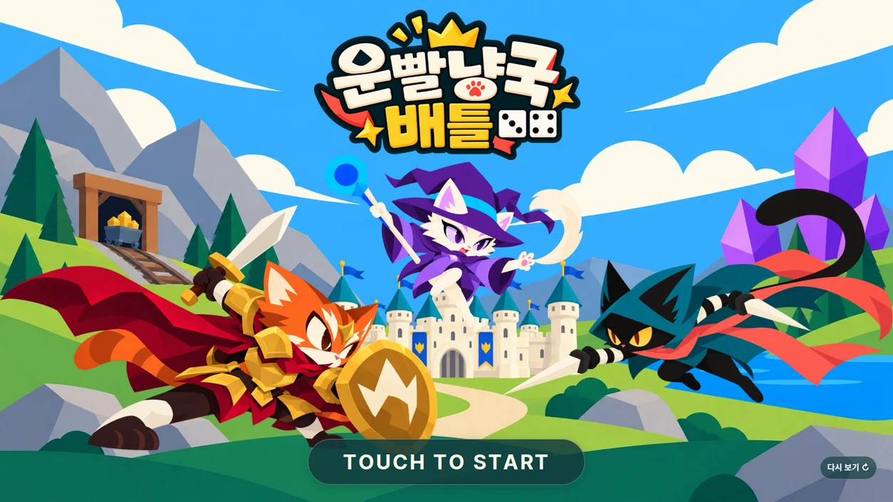

# 운빨냥국배틀

주사위로 자원을 얻고, 카드로 고양이 병사와 건물을 배치하는 턴제 판타지 영토 게임입니다. 이름은 가칭입니다.

안개 속 시작 위치, 자원을 주는 숫자, 뽑히는 카드가 매 판을 바꿉니다. 얻은 운을 바탕으로 냥국을 넓히고 상대 왕성을 공략합니다.

## 문서 안내

| 문서 | 내용 |
|---|---|
| [작업 지침](AGENTS.md) | 글쓰기, 파일명, 문서 갱신 방법 |
| [게임 설계](docs/game-design.md) | 현재 규칙, 클래스, 남은 설계 |
| [대화 맥락](docs/project-context.md) | 결정한 이유, 바뀐 규칙, 다음 작업 |
| [카드 목록](docs/cards.md) | 종족별 카드 제안(유닛·건물·마법·함정) |

## 폴더 안내

| 폴더 | 내용 |
|---|---|
| `assets/` | 원본 그림. 콘셉트, 타이틀 PNG와 배치 기준 `layout.json`, 지도 그림(`map/`), 성·재화 아이콘·카드 뒷면 등 게임 말(`game/`) |
| `src/` | 게임 코드. 규칙은 `board.js`(판 데이터), 화면은 `main.js`(타이틀·대전 방식 선택)·`map-screen.js`(판) |
| `tests/` | 자동 검사 |
| `scripts/` | 그림 정리·변환, 웹앱 설정 검사 |
| `public/` | 홈 화면 앱 설정, 글꼴 라이선스 |
| `docs/` | 설계·맥락 문서와 README 그림 |
| `.github/`, `.agents/` | 자동 배포 설정, GPT용 Ponytail 지침. 도구가 정한 자리라 옮기지 않음 |

`node_modules/`, `dist/`, `public/title/`, `public/map/`, `public/game/`, `public/icons/`, `src/generated/`는 자동으로 생깁니다. 저장소에 올리지 않고, 지워도 다시 만들어집니다.

현재는 **4단계 세로 전환과 판 만들기**를 진행 중입니다. 타이틀에서 시작하면 임시 대전 방식 선택 화면이 나오고, **1대1 매치** 또는 **4인 매치 → 개인전·팀전**을 고르면 새 무작위 대륙이 열립니다. 상대는 모두 봇이고 아직 움직이지 않습니다. 판은 바닥 타일·호수·지형 오브젝트·성 그림으로 그립니다. 판 아래 가운데 **모드 바꾸기**(임시)로 선택 화면에 돌아갑니다. 주소 끝에 `#map`(1대1), `#map-ffa`(4인 개인전), `#map-team`(팀전)을 붙이면 판으로 바로 들어갑니다. 화면 흐름과 개발 순서는 [대화 맥락](docs/project-context.md)에 있습니다.



## Safari에서 검증

[웹앱 열기](https://proid97.github.io/Project_catfantagy/)

`main` 브랜치를 GitHub Pages에 자동으로 올립니다. 링크를 아는 사람은 누구나 열 수 있습니다(공개). Safari에서 열어 타이틀 화면이 보이는지 확인합니다.

1. Safari의 **공유 → 홈 화면에 추가**를 누릅니다.
2. **웹 앱으로 열기**가 보이면 켜고 추가합니다.
3. 홈 화면의 **냥국배틀** 아이콘으로 실행합니다.

확인할 것: 인트로, 대전 방식 선택과 뒤로 가기, 세 모드의 판, 판의 확대·이동·칸 선택·미니맵, 모드 바꾸기, 가로·세로 회전. 게임 화면은 세로형이라 가로로 돌리면 가운데 세로 기둥으로 보입니다. 타이틀도 세로 구도이며, 가로로 돌리면 같은 기둥으로 보입니다. 인터넷 연결이 필요합니다.

움직임이 보이지 않으면 오른쪽 위의 **↻(연출 다시 보기)**를 누릅니다. 전체 동작을 한 번 재생하며 선택은 저장하지 않습니다. 계속 전체 동작으로 보려면 **움직임: 전체/줄임** 버튼으로 바꿉니다. 이 선택은 다음 실행에도 기억합니다. 처음에는 기기의 ‘동작 줄이기’를 따릅니다. 기기 성능에 따라 자동으로 모션을 없애지는 않습니다. 저장이 차단된 브라우저에서는 현재 실행에만 적용됩니다.

홈 화면 이름·아이콘·독립 실행 설정을 포함했습니다. 오프라인 캐시는 넣지 않았습니다. 업데이트 뒤에는 앱을 완전히 닫고 다시 엽니다.

배포 방법:

- `main`에 push하거나 합치면 몇 분 안에 다시 배포합니다. 저장소 **Actions** 탭의 **Pages 배포**에서 진행을 봅니다.
- 처음 한 번만 저장소 주인이 설정합니다. **Settings → Pages → Build and deployment → Source**를 **GitHub Actions**로 바꿉니다.

## 실행

Node.js 22.12 이상에서 실행합니다.

```sh
npm ci
npm run dev
```

표시된 로컬 주소를 브라우저로 엽니다. `index.html`을 직접 열면 실행되지 않습니다. 휴대폰에서 접속할 때는 `npm run dev -- --host 0.0.0.0`을 쓰고 같은 네트워크의 PC 주소로 접속합니다.

```sh
npm run build
npm run preview
npm run check:web-app
npm run test:rules
npx playwright install chromium
npm test
```

테스트 전에는 빌드를 새로 만듭니다. `dist/`가 배포할 결과입니다. 하위 경로에서도 실행할 수 있도록 상대 경로로 빌드합니다. 외부 CDN 없이 이미지와 폰트를 제공합니다.

## 개발 도구

| 도구 | 쓰는 이유 |
|---|---|
| Vite | 개발 서버와 배포용 빌드 |
| Web Animations API | 이미지의 이동·회전·확대 연출. 별도 애니메이션 라이브러리 없이 처리 |
| Sharp | 원본 PNG에서 투명 여백을 잘라 WebP 생성 |
| fonteditor-core | 현재 화면에 쓰는 글자만 폰트에 남겨 용량 절감 |
| Playwright | 등장 순서, 화면 크기, 입력, 로딩 실패 자동 확인 |
| Pretendard | 실제 폰트 파일을 포함. 한글과 영문 UI에 적용 |

[Ponytail](.agents/skills/ponytail/SKILL.md)은 공식 저장소의 `6f1c2bf` 판을 포함했습니다. 기존 기능·브라우저 기본 기능을 먼저 쓰고, 필요한 라이브러리를 선택합니다. 출처: [DietrichGebert/ponytail](https://github.com/DietrichGebert/ponytail/tree/6f1c2bfff0c837d268929a7c4e490918eb4fab29), MIT 라이선스 포함.

배치 기준은 `assets/title/layout.json` 한 곳에서 수정합니다. UI 문구를 추가하면 `npm run assets`를 다시 실행해 필요한 글자를 포함합니다. 지형은 별도 PNG를 통째로 움직입니다. 이미지 내용에 따른 식별값을 URL에 붙여 이전 그림이 캐시에 남는 문제를 줄입니다.

아트는 ChatGPT 이미지젠으로 제작합니다. 메인 캐릭터와 타이틀 원본은 [게임 설계](docs/game-design.md#메인-콘셉트)에 있습니다. Pretendard의 글자 모양을 유지한 부분 글꼴을 생성합니다. OFL 라이선스에 맞춰 생성물 이름은 `Catfantagy UI`로 바꾸고, 원 저작권과 라이선스는 `public/licenses/pretendard.txt`에 포함했습니다.

같은 주제의 변경은 위 문서에 반영합니다. 이전 내용은 GitHub 변경 기록에서 확인합니다.

다음 작업과 단계별 완료 기준은 [개발 순서](docs/project-context.md#개발-순서)에 정리했습니다.
