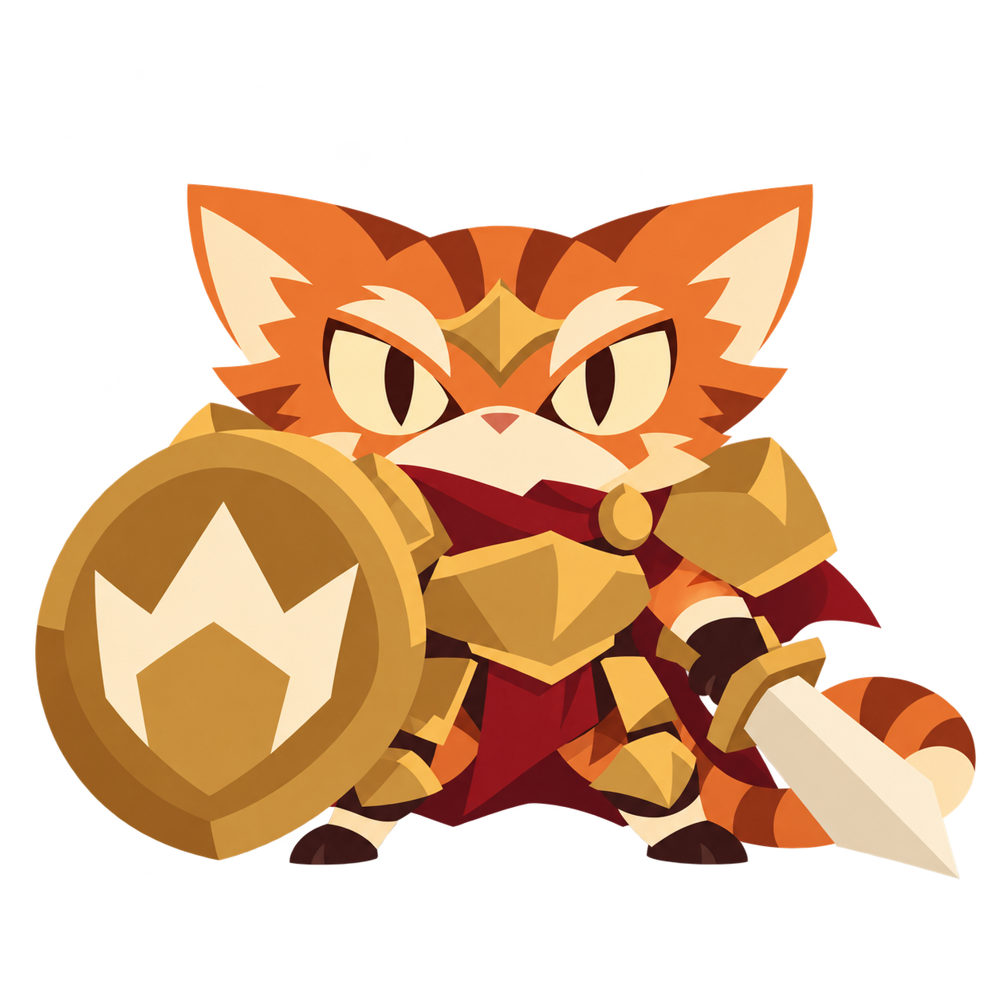
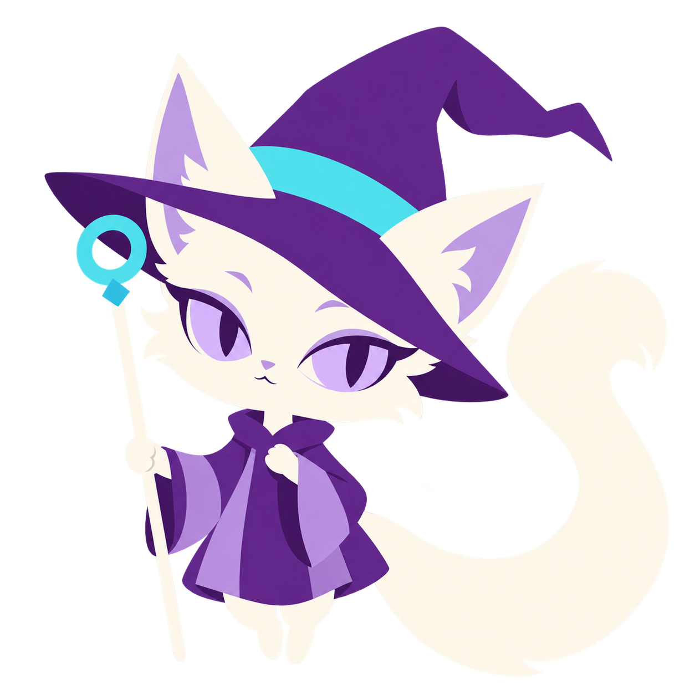
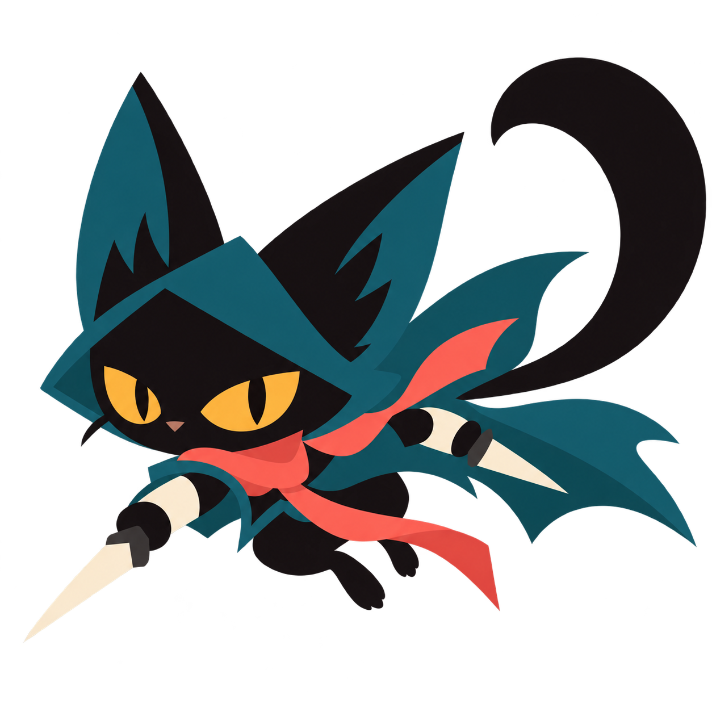
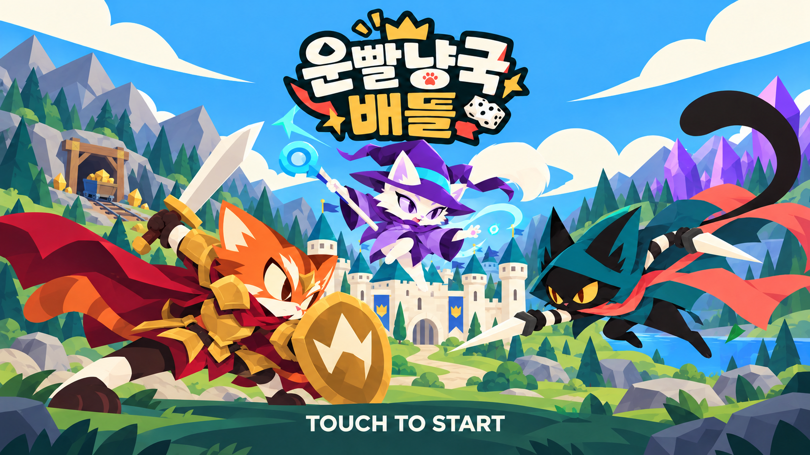

# 게임 설계

기준일: 2026-10-17 · 한국 시간

**합의**는 대화에서 정한 규칙입니다. **임시**는 첫 시험을 위한 선택이며 바꿀 수 있습니다. **미정**은 아직 값이나 판정이 없는 항목입니다. 별도 표시가 없는 본문은 합의한 내용입니다.

## 1. 어떤 게임인가

가칭은 **운빨냥국배틀**. 귀여운 판타지 고양이들이 주사위로 자원을 얻고, 카드로 건물과 유닛을 배치해 싸우는 턴제 영토 게임입니다.

**한 줄 구상:** 턴제 스타크래프트에 카탄식 자원 수급을 더한 세 종족 맞대결. 카탄식 플레이(주사위 운과 턴제 수급)가 중심이고, 유닛·건물로 전략을 더하며, 카드로 유닛·건물을 배치하는 운으로 도파민을 만듭니다.

- 시작할 때 냥전사·냥법사·냥살자 중 주력 클래스를 고릅니다.
- 시작 지형과 숫자는 안개에 가려져 있습니다. 자리 선택부터 운이 작용합니다.
- 좋은 카드일수록 더 많은 자원이 필요합니다. 뽑은 카드와 가진 자원에 맞춰 확장과 전투를 결정합니다.
- 상대는 봇 또는 다른 유저이며, 각자 자기 기기로 합니다. 한 기기를 돌려 쓰는 방식이 아닙니다. 프로토타입은 봇전 위주로 만들고 유저 대결은 나중에 더합니다.
- 기준 기기는 iPad mini 5입니다. **임시:** 화면은 가로 기준. 최종 플랫폼은 미정입니다.

## 2. 판과 건설

| 요소 | 놓이는 곳 |
|---|---|
| 자원·효과 | 육각 타일 |
| 유닛 | 타일 위 |
| 길 | 타일의 변 |
| 왕성·마을·건물 | 타일의 꼭짓점 |

냥성은 왕성과 같은 뜻이며, 문서에서는 **왕성**으로 통일합니다.

- 자원이나 효과가 있는 타일에는 **2~12** 중 숫자를 붙입니다. 주사위 두 개의 합과 비교합니다.
- 왕성을 제외한 건물은 자기 길로 왕성과 이어져야 활성화됩니다.
- 모든 건물은 자기·상대 건물을 포함해 바로 이웃한 꼭짓점에 지을 수 없습니다. 최단거리로 두 변 이상 떨어져야 합니다.
- 마을과 길은 카드 없이 자원으로 건설합니다. 다른 건물은 건물 카드와 비용이 필요합니다.
- 하나의 타일에서 여러 플레이어가 자원을 받을 수 있습니다. 이 구조에서는 길의 연결과 건설 자리 확보가 영토 확장입니다.

## 3. 시작 준비

1. 각자 주력 클래스를 고릅니다.
2. 주사위 한 개를 굴립니다. 중복이면 해당 사람만 다시 굴립니다. 큰 숫자부터 순서를 정합니다. 이 방식은 최대 6명까지 가능합니다.
3. 정한 순서대로 안개 속 시작 자리를 고릅니다.
4. 왕성 1개와 마을 1개를 서로 두 변 떨어진 꼭짓점에 놓고, 사이에 무료 길 2개를 놓습니다.
5. 각자의 덱에서 무작위 카드 5장을 뽑습니다.
6. 배치 순서대로 턴을 진행합니다.

**지난 임시 시험:** 지금 구현은 한 기기에서 두 사람이 클래스를 고르고 시작 순서 주사위를 굴립니다. 같은 클래스를 골라도 됩니다. 봇전 위주로 정해졌으므로 "나와 봇" 준비 화면으로 바꿀 예정입니다.

**임시:** 시작 건물에 접한 타일을 자기 시야에 공개합니다. 추가 시야 거리, 덱 구성, 시작 자원은 미정입니다.

## 4. 한 턴의 순서

1. **마나 회복:** 자기 유닛의 마나를 각각 1 회복합니다. 최대치를 넘지 않습니다. 체력 자동 회복은 없습니다.
2. **주사위:** 두 개를 굴려 타일 수급과 건물의 주사위 효과를 처리합니다.
3. **자동공격:** 정상 공격타워와 왕성이 범위 안의 적을 각각 1회 공격합니다.
4. **건설·카드 사용:** 길과 마을을 짓거나 카드를 사용합니다. 조건과 비용을 충족하면 여러 장 쓸 수 있습니다.
5. **유닛 명령:** 각 유닛에게 이동·공격 또는 스킬을 지시합니다.
6. **턴 종료:** 종료를 확인하면 카드 1장을 뽑습니다. 손패가 6장을 넘으면 골라 버려 6장으로 맞춥니다.

자동공격은 카드 사용 전이므로 이번 턴에 새로 지은 타워는 다음 자기 턴부터 공격합니다. 자동공격 대상 선정 방식은 미정입니다.

## 5. 자원과 건물 효과

누구의 턴이든 숫자가 맞으면 모든 플레이어의 해당 활성 건물이 수급합니다. 건물 하나는 꼭짓점에 접한 최대 세 타일의 효과를 받습니다.

| 건물 | 접한 타일의 자원·효과 | 건물 자체 기능 |
|---|---|---|
| 마을 | 타일 숫자가 나오면 획득 | 유닛 보유 상한 증가 |
| 효과 건물 | 타일 숫자가 나오면 획득 | 건물 고유 숫자가 나오면 효과 발동 |
| 공격타워 | 타일 숫자가 나오면 획득 | 자기 턴에 범위 안의 적 자동공격 |
| 왕성 | 타일 숫자가 나오면 획득 | 체력 보유, 주변 적 자동공격 |

- 같은 타일에 내 활성 건물이 두 개 접하면 두 건물 모두 수급합니다.
- 타일 숫자와 효과 건물 숫자가 같으면 수급과 고유 효과를 함께 처리합니다.
- 파손되거나 왕성과 연결이 끊긴 건물은 수급과 고유 기능이 정지합니다. 연결만 끊겼다면 길을 다시 이었을 때 재활성화됩니다.
- 숫자별 확률은 다릅니다. 7은 6/36, 6·8은 각각 5/36, 2·12는 각각 1/36입니다.
- 자원 종류, 타일별 지급량, 건설·소환 비용과 자원 교환 규칙은 미정입니다.

## 6. 카드와 유닛 행동

| 카드 | 사용 방법 | 비용 |
|---|---|---|
| 마법 | 조건을 충족하면 자기 카드 사용 단계에 사용 | 자원 비용 없음 |
| 함정 | 조건을 충족하는 곳에 설치, 발동 조건이 맞으면 상대 턴에도 작동 | 자원 비용 없음 |
| 유닛 | 필드에 소환 | 카드에 적힌 비용 |
| 건물 | 건설 규칙을 지켜 설치 | 카드에 적힌 비용 |

**임시:** 마법은 사용 후, 함정은 한 번 발동한 뒤 버립니다. 덱이 비면 버린 카드를 섞어 새 덱으로 씁니다. 함정 공개 여부와 효과가 동시에 발생했을 때의 순서는 미정입니다.

유닛은 체력·마나·기동력을 갖습니다. 체력은 피해를 받으면 줄고, 마나는 이동·공격·스킬에 씁니다.

| 선택 | 행동과 비용 |
|---|---|
| 일반 행동 | 이동 최대 1회와 공격 최대 1회. 각각 마나 1 소모 |
| 스킬 | 해당 유닛의 이번 턴 이동·공격을 모두 대신함. 마나 비용은 스킬별 설정 |
| 대기 | 행동하지 않음 |

- 이동 한 번으로 기동력 이내의 칸을 갑니다. 이동을 여러 번 나눠 쓰지 않습니다.
- 이동 후 공격하거나, 공격 후 이동할 수 있습니다. 이미 일반 행동을 했다면 그 턴에는 스킬을 쓸 수 없습니다.
- **임시:** 새로 소환한 유닛은 그 턴에 행동하지 않습니다.
- **임시:** 보유 상한은 `1 + 정상·활성 마을 수`, 최대 6기입니다. 시작 상한은 2기입니다.
- 상한이 줄어도 기존 유닛은 유지합니다. 현재 수가 상한보다 적어져야 추가 소환할 수 있습니다.
- 최대 마나, 소환 시 마나, 피해 계산, 타일당 유닛 수는 미정입니다.

## 7. 세 클래스

상성 방향은 **냥전사 → 냥살자 → 냥법사 → 냥전사**입니다. 실제 피해량과 비용은 아직 검증하지 않았습니다.

| 클래스 | 주요 특징 | 유닛과 기동력 |
|---|---|---|
| 냥전사 | 높은 체력, 도발, 근접전 | 방패냥 1·도끼냥 1·냥기사 2칸 |
| 냥법사 | 넓은 범위 공격, 예측공격 | 견습법사냥 1·대마법냥 1·빗자루냥 2칸 |
| 냥살자 | 은신, 빠른 접근, 도약공격 | 도둑냥 2·단검냥 2·그림자냥 3칸 |

냥전사·냥법사의 기동력과 냥전사의 개별 유닛명은 권장안을 채택한 시험안입니다. 개별 유닛의 나머지 능력은 미정입니다.

### 은신과 도약공격

- 지도 시야·은신 탐지·공격 범위는 따로 판정합니다. 일반 유닛은 인접 1칸에서 은신을 발견합니다.
- 냥살자는 탐지 범위 밖에서 숨습니다. 예측공격은 숨어 있는 적에게도 피해를 줍니다.
- 도약공격은 최대 1칸 도약해 공격한 뒤, 대상 바로 뒤의 인접 칸에 착지합니다. 착지 칸이 막혀 있으면 사용할 수 없습니다.
- 공격한 냥살자는 자기 다음 턴 시작까지 공개됩니다. 이후에도 탐지 범위 안이면 숨지 못합니다.
- 마나를 쓰는 특수 건물로 안개와 은신을 밝힐 수 있습니다.
- 육각판에서의 방향, 도약 거리와 착지 거리의 정확한 계산, 도약공격의 행동 분류는 미정입니다.

### 전투의 야옹

- 전사냥의 도발 스킬입니다. 발견한 범위 내 적에게 적용합니다. 정확한 범위는 미정입니다.
- 대상은 자기 다음 턴 시작에 시전자 쪽으로 1칸 이동하고, 이후 정상적으로 명령을 받습니다.
- 이미 인접했거나 갈 수 없으면 제자리에 있습니다. 도발은 중첩되지 않습니다.
- 은신한 적은 먼저 발견해야 도발할 수 있습니다.

### 법사 공격 모양

| 유닛 | 사용자가 정한 공격 형태 |
|---|---|
| 견습법사냥 | 한 칸 띄우고 가로로 3칸 |
| 대마법냥 | 한 칸 띄우고 3칸 덩어리 |
| 빗자루냥 | 바로 앞부터 일자로 2칸 |

육각판의 정확한 타격 칸은 다음 설계에서 그림으로 정합니다. 대마법냥의 ‘3칸 덩어리’를 임의로 3×3으로 확대하지 않습니다.

## 8. 건물 파손과 왕성

- 일반 건물은 체력 수치 대신 **정상 → 첫 피격에 파손·효과 정지 → 두 번째 피격에 파괴**로 처리합니다.
- 왕성은 별도 체력을 갖습니다. 일반 건물의 두 번 피격 규칙을 적용하지 않습니다.
- 왕성은 범위 안의 적을 자기 턴에 자동공격합니다.
- 자기 길로 연결되어 있고 왕성에서 최단 두 변 이내인 다른 정상 건물이 하나라도 있으면 공격력이 강해집니다. 없으면 크게 낮아집니다.
- 강화 조건은 공격력에만 적용합니다. 지원 건물이 파손되면 즉시 조건을 다시 확인합니다.
- 유닛은 자기가 있는 칸의 꼭짓점에 놓인 상대 건물을 모두 공격할 수 있습니다.
- 수리, 길 공격 가능 여부, 왕성 체력·공격력·사거리, 다중 타격의 피격 횟수는 미정입니다.

## 9. 승리와 아트

왕성 파괴 승리와 목표 달성 승리를 구상했습니다. 길·건물 목표의 수치는 밸런스를 보고 정합니다.

**임시:** 첫 전투 시험은 1대1 왕성 파괴 승리로 진행합니다. 여러 명이 플레이할 때의 탈락 처리와 최종 승자 판정은 미정입니다.

아트는 **ChatGPT 이미지젠**으로 만듭니다. 귀여운 고양이와 클래식 판타지를 바탕으로 합니다.

- **유닛 표현은 토큰 스타일로 결정했습니다.** 피규어·종이 스탠드·토큰의 플레이 화면을 비교한 뒤 선택했습니다.
- 팔다리를 따로 움직이는 애니메이션은 만들지 않습니다. 정적 토큰 전체를 코드로 이동·회전·확대·축소해 움직임과 공격을 표현합니다.
- 근접공격은 토큰 전체가 부딪히는 연출을 사용합니다. 마법은 코드로 생성한 효과나 이를 이미지로 만든 효과를 활용합니다.
- 캐릭터의 메인 콘셉트는 아래 세 이미지입니다. 큰 눈·과장된 비율·단순한 벡터풍 색면으로 통일하고, 색·실루엣·자세로 클래스를 구분합니다.
- 플레이 화면 모크업의 UI·지도·자원과 수치는 최종안이 아닙니다. UI·건물·맵 디자인, 게임 시점과 해상도는 미정입니다. 가로형 비교 화면만으로 플랫폼이나 화면 방향을 확정하지 않습니다.

### 메인 콘셉트

2026-10-16 선택. 원본 PNG를 수정하지 않고 보관합니다. 앞으로 캐릭터를 제작할 때 참고할 기준이며, 실제 토큰의 테두리·방향 표시·출력 크기는 추후 정합니다.

| 냥전사 | 냥법사 | 냥살자 |
|---|---|---|
|  |  |  |
| 주황·금색·진홍, 넓게 버티는 자세 | 흰색·보라·청록, 곧게 떠 있는 자세 | 검정·청록·코랄, 낮게 도약하는 자세 |

법사냥은 색과 자세를 바꾼 뒤 나온 **세 번째 이미지**를 선택했습니다. 빛 번짐이 강했던 앞의 두 이미지는 기준으로 쓰지 않습니다.

### 캐릭터 아트 기준

**합의:** 지금 그림체(벡터풍 색면, 큰 눈, 과장된 비율)를 유지합니다. **임시:** 아래 수치는 2026-10-17 타이틀 캐릭터 3종을 분석해 정한 첫 기준이며, 새 그림으로 검증하며 다듬습니다.

기준 시트: [character-art-reference.png](../assets/concepts/character-art-reference.png). 세 캐릭터의 얼굴과 눈 구조, 재질별 3단 색 견본, 빛 방향을 담았습니다.

| 항목 | 기준 |
|---|---|
| 빛 | 왼쪽 위 한 방향. 밝은 면은 왼쪽·위, 그림자는 오른쪽·아래 |
| 명암 | 재질마다 **3단**(밝은 면·기본·그림자). 단계 사이는 단색 경계이고 그러데이션·얼룩·번짐은 없음. 그림자는 기본보다 확실히 어둡게, 색상은 살짝 붉거나 푸른 쪽으로 |
| 짙은 재질 | 검정·짙은 남색도 3단. 밝은 면을 푸른 회색으로 넣어 형태를 보이게 함 |
| 외곽 | 검은 외곽선 없음. 색면 경계로 형태를 만들고, 가장자리는 반투명 없이 또렷하게 |
| 눈 | 굵은 위 눈꺼풀 선 + 홍채 2단(기본·위쪽 그림자) + 동공 + 왼쪽 위 큰 **하이라이트** 1개(홍채 폭의 약 1/4). 작은 반사광은 넣지 않음. 흰자 유무와 동공 모양만 캐릭터 고유 |
| 색 수 | 캐릭터당 재질 6~8개 × 3단(기준 시트의 색 견본). 원본 PNG의 미세한 색 변형은 정리 단계에서 합쳐지므로, 검수는 정리 뒤 색 덩어리로 함 |
| 실루엣 | 검게 칠해도 클래스가 읽힘. 머리·귀 둘레는 망토·소품과 겹치지 않게 트고, 대표 형태 하나(전사 방패, 법사 모자·지팡이, 냥살자 꼬리·단검)를 크게 |
| 비율 | 머리 : 몸 = 1 : 1.2~1.6. 72px 토큰 크기에서도 얼굴이 보임 |
| 작은 디테일 | 하이라이트·코·발바닥은 긴 변 1672px 기준 지름 10px 이상. 정리 과정에서 사라지지 않게 함 |
| 접지 | 서 있는 발은 바닥면이 평평하게 보임. 공중 자세는 몸 아래를 비워 떠 있음을 보여 줌 |

**부위별 현황** (2026-10-17 재제작과 잔여 정리 뒤, 점검 시트: [character-art-check.png](images/character-art-check.png))

| 부위 | 냥전사 | 냥법사 | 냥살자 |
|---|---|---|---|
| 눈 | 두 눈이 보이고 하이라이트 있음 | 기준과 같음 | 하이라이트 추가, 세로 동공 경계의 흔적 제거 |
| 몸·옷 | 금 갑옷을 큰 판으로, 방패 테두리를 큰 금색 면 3개로 단순화 | 목의 잔면을 넓은 천 면으로 정리 | 검은 몸에 푸른 회색 밝은 면이 생겨 형태가 읽힘 |
| 천 | 망토를 줄여 머리·귀가 드러남 | 모자 챙에 귀가 지나가는 홈을 내 접점 정리 | 머플러 면적을 줄이고 3단으로 |
| 다리·소품 | 뒷발에 바닥면이 생김. 가죽은 짙은 갈색(회색 기운은 밝은 면에만) | 다리 길이가 자연스럽고 지팡이는 나무색 | 줄무늬 소매·단검·말린 꼬리 유지 |
| 정리 전 색 → 정리 뒤 색 덩어리 | 53,083 → 205 | 45,866 → 155 | 41,452 → 135 |

- 원본 PNG는 몸 안쪽까지 알파 128~254로 살짝 투명하고, 배경에 옅은 잡티가 있습니다(이전 그림도 같음). 정리 단계에서 완전 불투명·완전 투명으로 바뀝니다.
- 지금 기준으로 남은 아트 문제는 없습니다.

**생성과 정리 공정**

1. 이미지젠 요청 끝에 아래 공통 문구를 붙입니다.
   ```text
   Flat vector game illustration in the same style as the reference. Hard-edged cel shading with exactly three tones per material (highlight, base, shadow), single light source from the upper left. No gradients, no texture, no grain, no noise, no glow, no blur. Crisp clean edges, no black outlines, fully transparent background with no semi-transparent fringe. Eyes: thick upper lid line, two-tone iris, one large clear white highlight at the upper left, no small secondary reflection. Smallest details at least 10 px wide. Head-to-body ratio about 1:1.4.
   ```
2. 생성 원본 PNG는 그대로 커밋합니다. 정리는 `npm run assets`가 실행용 WebP를 만들 때 자동으로 합니다. 반투명 가장자리를 알파 128 기준으로 또렷하게 하고, [vtracer](https://github.com/visioncortex/vtracer)(`@neplex/vectorizer`)로 색면 도형을 다시 딴 뒤 원래 크기로 되돌립니다. 설정은 `colorPrecision 6`, `layerDifference 16`, `filterSpeckle 6`, `cornerThreshold 60`입니다. 잘라 쓸 영역도 정리된 그림에서 자동으로 재므로, 그림을 바꿔도 `layout.json`을 고칠 필요가 없습니다. 그림의 일부만 쓰는 층(하늘, 나무 왼쪽·오른쪽)만 `sourceBounds`를 적습니다.
3. 새 그림을 넣으면 같은 부위를 3배 확대해 원본과 비교합니다. 눈 하이라이트와 작은 디테일이 남았는지 확인합니다.

적용 결과(타이틀 13층): 얼룩과 번짐이 사라지고 모서리와 3단 명암은 유지됐습니다. 실행 이미지는 0.67MB에서 0.48MB로, 첫 로딩은 약 0.73MB에서 0.54MB로 줄었습니다. `filterSpeckle 10`에서는 성문 아치의 가는 선과 작은 반사광이 사라져 6으로 낮췄습니다. 그림을 새로 처음부터 만들 때는 약 20초가 걸립니다.

### 타이틀 화면

2026-10-16 선택, 2026-10-17 저장. 광산을 복원하고 세 캐릭터의 대결 자세를 강화한 마지막 시안을 기준으로 합니다. 원본 PNG를 그대로 보관합니다.



원본은 시안이고, 실행 화면의 구성은 아래 항목을 따릅니다.

- **배경:** 푸른 하늘, 동산, 뒷산. 왼쪽에 광산 입구·레일·수레, 오른쪽에 수정 지형, 가운데에서 조금 오른쪽에 왕성을 둡니다. 앞쪽의 어두운 언덕과 모서리 바위·덤불이 광산·수정산·왕성의 아랫부분을 가립니다.
- **캐릭터:** 전사냥은 왼쪽 아래에서 돌진하고, 냥살자는 오른쪽 아래에서 도약해 가운데로 맞붙습니다. 법사냥은 왼쪽 위 하늘에 떠서 성을 가리지 않습니다. 전사냥의 발은 땅에 붙입니다.
- **구성:** 왕성은 이전의 약 70% 크기입니다. 발바닥 깃발이 로고와 겹치지 않습니다. 왼쪽 광산과 오른쪽 수정산은 끝까지 보입니다. 성은 참고한 성의 탑·성벽·나무문 구성을 새로 그렸으며, 청록 지붕에 붉은 깃발 하나와 밝은 발바닥 문양을 넣습니다.
- **그림:** 깔끔한 벡터풍 색면을 바탕으로 지형과 건물에 적당한 디테일을 더합니다. 거친 텍스처와 지나친 잔장식은 줄입니다.
- **문구:** 위에는 가칭 타이틀 ‘운빨냥국배틀’, 아래 어두운 앞쪽 언덕 위에는 **TOUCH TO START**. 일반 UI와 시작 문구는 실제 **Pretendard** 폰트를 씁니다. 시작 문구는 테두리 그림자가 있는 크림색 글자이며 버튼 모양은 없습니다.
- **화면 맞춤:** 그림은 1672×941입니다. 가운데 4:3 안전 영역(가로 209~1464, 세로 전체, `layout.json`의 `safeArea`)이 항상 보이게 키웁니다.
  - 4:3 화면(iPad mini 5)은 띠 없이 꽉 차며, 16:9 그림의 양옆이 잘립니다. 홈 화면 앱에서는 위쪽 상태 표시줄 자리(실측 32)를 하늘색 바탕으로 두고 그 아래를 채웁니다.
  - 더 넓은 화면이나 세로 화면은 남는 곳을 그림 가장자리 색의 그라데이션으로 채웁니다.
- **인트로:** 약 2.7초(2680ms에 끝남). 순서는 아래와 같습니다.
  1. 하늘이 천천히 자리 잡습니다. 페이드는 없습니다.
  2. 동산과 앞쪽 언덕이 아래에서 올라옵니다.
  3. 뒷산이 동산 뒤에서 올라옵니다.
  4. 광산·나무·수정산·왕성이 앞쪽 언덕 뒤에서 올라옵니다. 반투명한 중간 모습은 없습니다.
  5. 전사냥(1.3초)과 냥살자(1.42초)가 달려 들어옵니다.
  6. 법사냥이 하늘에서 튀어나옵니다(1.72초).
  7. 로고가 찍히듯 내려앉습니다(2.12초).
  8. TOUCH TO START가 떠오릅니다.
- **움직임 방식:** 한 구간 안에서 살짝 넘쳤다가 돌아옵니다. 멈췄다가 다시 움직이지 않습니다. 화면 전체를 흔들지 않습니다.
- **입력:** 연출 중에는 화면 아무 곳이나 누르거나 Enter·Space를 눌러도 건너뛰기만 합니다. 게임은 시작하지 않습니다.
- **움직임 줄임:** 같은 순서로 0.3초 페이드만 씁니다. 대기 연출이 없습니다.
- **버튼:** 오른쪽 위에 작은 알약 모양으로 건너뛰기, 움직임 전체/줄임, 다시 보기(↻)를 둡니다. 다시 보기는 전체 연출을 한 번 보여주며 설정을 저장하지 않습니다. 저장하는 것은 움직임 전체/줄임뿐입니다.

가로형 모크업 선택만으로 게임 전체의 플랫폼이나 화면 방향을 확정하지 않습니다. 최종 플랫폼과 화면 방향은 아직 미정입니다.

### 타이틀 분리 이미지

현재 쓰는 원본 PNG 12종은 `assets/title/`에서 관리합니다. 하늘을 제외한 11장은 투명 배경입니다. 나무 한 장은 빌드 때 왼쪽·오른쪽 둘로 나눠, 실행할 때는 13개 층을 씁니다. 언덕·뒷산·광산·수정산을 따로 그려, 등장 중 지형이 가로로 잘리는 문제를 없앱니다. 기존 타이틀 원본은 그대로 보관합니다.

| 파일 | 내용 |
|---|---|
| [sky.png](../assets/title/sky.png) | 하늘과 구름 |
| [mountains.png](../assets/title/mountains.png) | 봉우리가 적은 먼 뒷산 |
| [hills.png](../assets/title/hills.png) | 녹색 동산·길·호수·앞쪽 땅 |
| [trees.png](../assets/title/trees.png) | 소수의 침엽수. 왼쪽·오른쪽 두 층으로 나눠 씀 |
| [mine.png](../assets/title/mine.png) | 온전한 광산 입구·수레·레일 |
| [crystals.png](../assets/title/crystals.png) | 수정 세 개와 작은 받침 지형 |
| [castle.png](../assets/title/castle.png) | 청록 지붕과 큰 붉은 발바닥 깃발의 왕성 |
| [foreground.png](../assets/title/foreground.png) | 어두운 앞쪽 언덕과 모서리 바위·덤불. 광산·수정산·왕성의 아랫부분을 가리고, 시작 문구의 어두운 바탕이 됨 |
| [warrior.png](../assets/title/warrior.png) | 돌진하는 전사냥. 왕관 방패는 콘셉트와 같음 |
| [mage.png](../assets/title/mage.png) | 하늘에 떠 있는 법사냥. 지팡이 고리는 콘셉트와 같음 |
| [assassin.png](../assets/title/assassin.png) | 도약하는 냥살자 |
| [logo.png](../assets/title/logo.png) | ‘틀’을 정리하고 정면 정사각형 주사위 두 개를 넣은 로고 |

- **TOUCH TO START는 어느 PNG에도 포함하지 않습니다.** 실제 Pretendard 폰트를 사용해 코드로 표시합니다.
- 파일별 크기와 투명 여백이 달라 단순히 같은 위치에 겹치면 원본 구도가 나오지 않습니다. [layout.json](../assets/title/layout.json)이 현재 배치의 기준입니다. 층마다 자를 영역(`sourceBounds`)·위치·겹침 순서를 담고, 나무는 같은 파일에서 두 영역을 잘라 씁니다.
- 로고 수정본은 눈으로 확인했습니다. 주사위는 떨어진 두 정사각형이며, 눈은 각각 3개·4개입니다. 지형도 원본과 비교해 나무·봉우리·잔디테일을 줄였습니다.
- [prompts.json](../assets/title/prompts.json)은 이미지젠 제작·수정 프롬프트 기록입니다. 실행용 이미지는 이 원본에서 생성합니다.

### 대기 화면 움직임

**임시:** 시작 문구 밝기와 법사냥 부유만 적용했습니다. 둘 다 몇 번만 하고 멈춥니다. 나머지는 **미정**이며 구현하지 않았습니다.

| 요소 | 내용 | 이유 | 상태 |
|---|---|---|---|
| 시작 문구 | 2.4초 간격으로 밝기만 부드럽게 변화. 3번 뒤 멈춤(약 7초) | 누를 위치를 알려줌 | 임시 · 적용 |
| 법사냥 | 3.2초에 걸쳐 오르거나 내림. 2번 왕복 뒤 멈춤(약 13초) | 공중에 뜬 자세를 살림 | 임시 · 적용 |
| 뒷산·하늘 | 20~30초에 걸쳐 좌우 2~4px 이동 | 앞뒤 거리감을 줌. 반복 경계가 보이지 않게 왕복 | 미정 |
| 수정·지팡이 | 3~5초 간격의 작은 별빛 1~2개 | 넓은 화면에 시선을 분산하지 않고 생기를 줌 | 미정 |
| 깃발 | 천과 깃대를 추가 분리해 흔들기 | 성에 생기를 줌 | 미정 |

전사냥·냥살자·성·로고는 고정해 대치 구도와 무게감을 지킵니다. 적용한 두 연출은 인트로가 끝난 뒤 시작하고, transform·opacity만 씁니다. 끝없이 반복하지 않으므로 멈춘 뒤에는 화면을 다시 그리지 않습니다. 게임을 시작해 타이틀이 가려지면 멈추고, 타이틀로 돌아오면 같은 횟수만큼 다시 합니다. ‘움직임 줄임’에서는 켜지 않습니다.

## 10. 화면과 조작

2026-10-17 사용자 구상. 맵·미니맵·패 보기는 상대 턴에도 언제나 쓸 수 있습니다.

| 위치 | 요소 | 동작 |
|---|---|---|
| 가운데 | 맵 | 두 손가락으로 확대·축소, 끌어서 이동 |
| 왼쪽 위 | 내 프로필, 그 아래 상대 닉네임 목록 | 상대가 주사위를 굴리면 닉네임 옆에 작은 주사위 2개가 나옴 |
| 오른쪽 위 | 보유 재화 | 아이콘과 숫자를 가로로 나열 |
| 왼쪽 아래 | 단순한 미니맵 | 누르면 화면 가운데에 크게 열림. 큰 미니맵은 내 시야 안에서 누가 어디에 배치 중인지 보는 용도. 큰 미니맵을 누르면 닫히며 누른 곳으로 화면 이동 |
| 오른쪽 아래 | 겹쳐 놓은 내 카드 | 누르면 아래에 패가 펼쳐짐. 카드 하나를 누르면 가운데로 나오며 크게 보임 |

- **내 턴 주사위:** 화면 가운데에서 누르면 주사위가 튀어 올랐다 떨어집니다. 나온 숫자의 **필드 타일**이 반짝이고, 그 타일에서 자원 아이콘이 아이템처럼 떨어집니다. 떨어진 아이콘은 오른쪽 위의 같은 재화 아이콘으로 쏙 빨려 들어가고, 재화 칸이 또리링 반응하며 숫자가 오릅니다.
- **카드 사용:** 패를 펼쳐 카드를 맵으로 끌어다 놓습니다. 건물은 놓을 꼭짓점을, 유닛은 놓을 칸을 고릅니다.
- **유닛:** 칸 위에 올라가는 토큰이며 칸 단위로 이동합니다.

## 11. 다음에 정할 것

1. 육각판의 이동·공격·도약·방향 그림과 타일당 유닛 수.
2. 자원 종류, 시작 자원, 덱 구성과 건설·소환 비용.
3. 유닛 체력·최대 마나·소환 마나·공격 피해와 왕성·타워 수치.
4. 안개 공개 범위, 함정 판정, 수리·길 차단 규칙.
5. 실제 판을 돌린 뒤 클래스 상성과 승리 목표 조정.
6. 대전 인원(1대1·3인)과 인원별 판 크기, 봇도 안개를 적용받는지.
